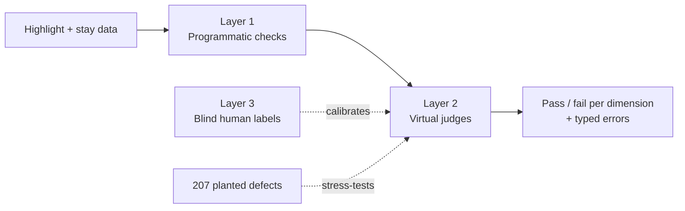

# Calibrating virtual judges for AI listing highlights

*Content design × LLM-as-a-judge · independent case study by Jen Kelleman*

> [!NOTE]
> **Independent portfolio project.** It isn't affiliated with or endorsed by Airbnb. All homes are invented. It's modeled on Airbnb's [Fall 2026 AI listing descriptions](https://news.airbnb.com/en-au/airbnb-2026-september-update) and on the approach in Airbnb Engineering's [Eval-driven development](https://airbnb.tech/ai-ml/eval-driven-development-lessons-from-evaluating-genai-at-scale/).

## At a glance

| | |
|---|---|
| **Surface** | AI-written listing highlights: the one or two sentences a guest reads under a stay in search results |
| **Question** | How do you turn a content designer's standards into virtual judges (VJs) that agree with careful human reviewers, and prove it? |
| **Approach** | Three layers: programmatic checks, then one VJ per dimension, then blind human labels to calibrate against |
| **Scale** | 30 invented stays · 60 candidate highlights · 207 planted defects · 3 VJs · 20 automated tests |
| **Status** | Stack built and tested. Human labeling is underway, and results will come from labeled runs only |

## Why it matters to guests

A highlight is a promise. If it's wrong, a guest books on something that isn't true. If it's generic, it wastes the one line they read.

| What the data says | What a model wrote | What the guest experiences |
|---|---|---|
| Beach is a 4-minute walk on a public path | "An **oceanfront** five-bedroom…" | Expected to step onto the sand |
| Plunge pool is **shared** with the host's house | "…with **its own** saltwater plunge pool" | Finds the host's family in the pool |
| Pool is **not heated** | "…a **heated** saltwater pool…" | A cold swim in a desert winter |
| Old Port is an **18-minute** walk | "…**a short walk** from the Old Port" | A longer walk than planned, every day |
| 1950s homestead cabin with a cowboy tub and a telescope | "**Escape to your own desert oasis!**" | Learns nothing about the stay |

Nobody can read every highlight, so quality depends on automated judges. **A judge that hasn't been calibrated is worse than none**, because it gives confident numbers that don't match what guests experience.

## How the stack works

| Layer | What it decides | Examples |
|---|---|---|
| **1 · Programmatic checks** | Anything countable or exactly matchable | Length, `!`, emoji, stock clichés, "oceanfront" with no water frontage |
| **2 · Virtual judges** | Anything that needs reading comprehension, with one judge per dimension | **Faithfulness:** is every claim true? **Salience:** does it name what makes this stay different? **Voice:** is it specific, plain, and calm? |
| **3 · Human evaluation** | The answer key, and the final call on what "good" means | Blind labels, inter-rater agreement, disagreement review |

## How it follows Airbnb's rules for virtual judges

Airbnb's eval post lists rules for building LLM evaluators. Here's how each one shows up in this stack:

| Airbnb's guidance | In this stack |
|---|---|
| One evaluator per dimension, no "God evaluators" | Three single-purpose VJs replace a four-dimension rubric ([why](docs/rubric_v1_to_v2.md)) |
| Use a different judge than the generator | The CLI warns if the judge and generator come from the same model family |
| Few-shot examples, including bad ones | Every VJ has worked pass and fail examples, all from stays outside the golden set |
| Explicit output schema | Each VJ returns strict JSON with typed errors. Malformed replies are recorded, never scored |
| Clear, binary scoring | Pass/fail per dimension. Faithfulness is scored one claim at a time in code |
| Calibrate before trusting at scale | Inter-rater α first, then κ with confidence intervals and fail recall per VJ |
| Start with 50–100 rows, including failures | 60 highlights, about half written to fail in a specific way |

## Key decisions

| Decision | Why | Guest impact |
|---|---|---|
| **Distance gets a defined vocabulary** | "Steps from" and "a short walk" had no shared meaning | "Steps from" means 2 minutes or less on foot, and "a short walk" means 10 or less |
| **Faithfulness is scored claim by claim** | A holistic judge can "round up" a summary that's mostly true | One false detail always fails the highlight |
| **Salience gets a reference list** | "Most compelling features" turns into the judge's own taste | Highlights lead with the A-frame, not the Wi-Fi |
| **Honest negatives are protected** | Judges tend to read "no elevator" as a flaw | "It's a third-floor walk-up" passes, and the wrong guest doesn't book |
| **Counting moves to code** | LLMs miscount characters, and listed phrases are exact matches | Format rules are enforced every time, at no cost |
| **Context words move from regex to judge** | The first run flagged "an apple orchard on the **property**," where the word means land | Fewer false alarms on good copy |

Full list: [decision log](docs/decisions.md) · Guidelines: [content principles](docs/content_principles.md)

## Where it stands

**Built**
- [x] 30 stays and 60 highlights, each probing a specific failure or an honest negative that should pass
- [x] Seven content principles, each mapped to a rule and an enforcement layer
- [x] Layer 1 checks, three VJs, a pairwise VJ that runs in both orders, and a v1 baseline for comparison
- [x] 207 planted defects across eight types, plus untouched controls to measure false alarms
- [x] Metrics code (agreement, Cohen's κ with bootstrap intervals, fail recall, Krippendorff's α, length bias, test-retest) and 20 offline tests
- [x] A blind labeling tool that shuffles items per rater and hides the author's notes

**Next**
- [ ] Finish blind labeling, ideally with a second rater, and report inter-rater α as the ceiling
- [ ] Report v1 vs. v2 agreement, κ, and fail recall for each dimension
- [ ] Report catch rates for planted defects and false alarms on controls
- [ ] Review every disagreement, revise one rule, rerun, and report the before-and-after

> [!TIP]
> **What I'm watching for:** borderline distance cases should split raters before they split the judge. "A short walk" for an 18-minute walk tests whether the distance table matches how people actually read.

## In production

- **Monitor:** sample live highlights daily, run both layers, and route flagged items to a weekly review. Each new failure becomes a rule, an example, or a planted defect.
- **Gate releases:** recalibrate whenever the model or prompt changes, and gate on faithfulness fail recall, not average scores.
- **Learn from guests:** derive each stay's standout list from what guests filter on and click.
- **Grow the golden set:** add real model outputs and adversarial cases, and keep the few-shot examples separate from it.

## Limitations

60 items give wide confidence intervals, and the report shows them rather than hiding them. The hand-written highlights are harder than typical model output; `python -m evals generate` adds real outputs to close that gap.
