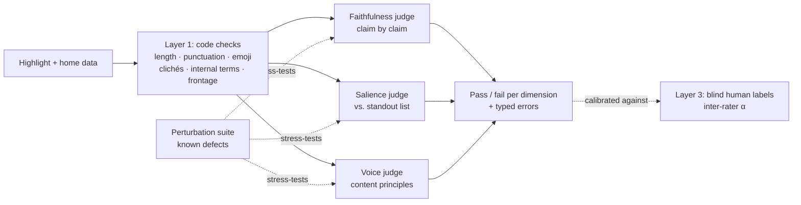

# Airbnb LLM-as-a-Judge Listing Evals

An evaluation stack for **AI-written listing highlights**: the one- or two-sentence descriptions a model writes under each home in a travel marketplace's search results.

The repo shows the full loop for making an LLM-as-judge trustworthy. Content principles become evaluable rules, rules go to the right layer (code, judge, or human), the judges are calibrated against blind human labels, and the judges themselves are stress-tested with injected defects.

> **Independent portfolio project.** Not affiliated with or endorsed by Airbnb. All 30 homes are invented; cities and landmarks are real places used for realism, and no data comes from Airbnb or any other booking platform.

**Start with [CASE_STUDY.md](CASE_STUDY.md)** for the story, the decisions, and where the project stands.

> **Status: in progress.** The stack is built and tested; blind human labeling is underway, and results will be published from real labeled runs.

## The stack



| Layer | What it decides | Why it decides it |
|---|---|---|
| 1. Code | Anything countable or exactly matchable | Free, exact, and never miscounts characters |
| 2. Virtual judges | Faithfulness, salience, voice — one judge each, binary, with typed errors | Each needs reading comprehension, and one dimension per judge keeps errors traceable |
| 3. Humans | Ground truth, rubric disputes, the final call on what "good" means | Judges are only as good as the labels they're calibrated to |

## What gets measured

- **Judge vs. human agreement** per dimension: % agreement, Cohen's κ with bootstrap 95% CI, and fail recall and precision. Fail is the positive class because missed failures are what reach guests.
- **Human vs. human agreement** (Krippendorff's α): the ceiling no judge can beat.
- **v1 vs. v2**: a typical monolithic rubric against the split stack, on the same labels.
- **Perturbation catch rates**: eight injected defect types, plus unchanged controls to measure false alarms.
- **Length bias, test-retest consistency, and pairwise position consistency.**
- **`results/disagreements.md`**: every item where the system and the labels disagree, with the judge's stated reasons. This is the file to read before changing any prompt.

## Quickstart

```bash
pip install -e ".[anthropic]"         # or .[openai]; no other dependencies
python data/build_seed.py             # (re)build the dataset
python -m pytest                      # offline; no API key needed

python -m evals all                   # offline smoke run with the mock judge (numbers are noise)

export JUDGE_PROVIDER=anthropic JUDGE_MODEL=<model id>
python -m evals label --rater yourname    # label blind first
python -m evals all --samples 3           # real run
```

To score model-written highlights instead of the hand-written seed set, set `GEN_PROVIDER` and `GEN_MODEL` to a **different model family** from the judge and run `python -m evals generate`. The judge command warns you if the families match.

## Repo map

```
data/        listings, candidate highlights, human labels (data/labels/<rater>.csv)
prompts/     one file per judge, versioned in a header comment; v1_monolithic is the baseline
evals/       checks.py (Layer 1) · judges.py · perturb.py · metrics.py · report.py · CLI
docs/        content principles · labeling guide · v1→v2 rationale · decision log
results/     report.md, metrics.json, disagreements.md (cache/ is gitignored)
tests/       20 offline tests, including scoring logic driven by scripted judge replies
```

## Further reading

- [Eval-driven development: lessons from evaluating GenAI at scale](https://airbnb.tech/ai-ml/eval-driven-development-lessons-from-evaluating-genai-at-scale/) — the three-layer framing and calibration targets this project follows
